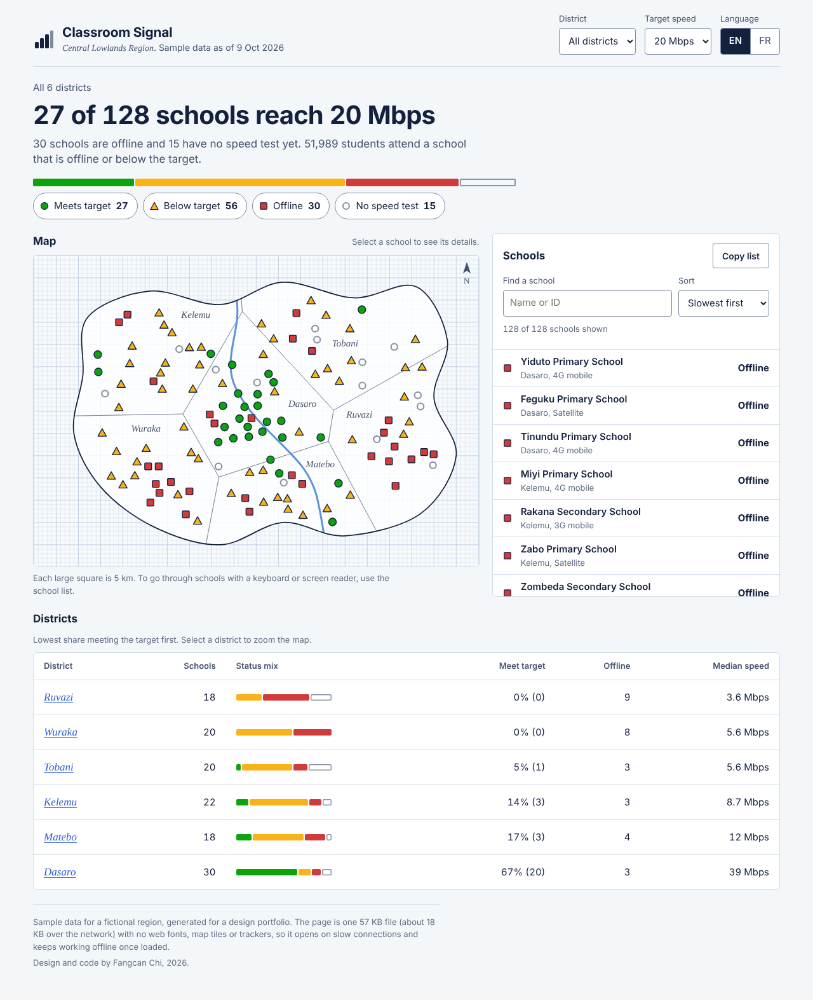

# Fangcan Chi

Electrical and Computer Engineering student at Zhejiang University and the University of Illinois Urbana-Champaign. I design and build interfaces for people with slow connections and small screens.

## Projects

### [Classroom Signal](projects/classroom-signal/)

A bilingual, low-bandwidth dashboard showing which schools in a region have usable internet: district map, school list and per-school speed history, in one 57 KB page. [Read the case study](projects/classroom-signal/case-study.html).

