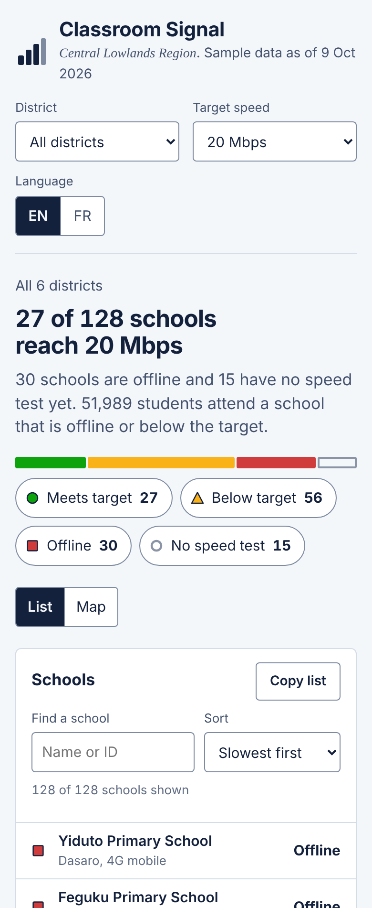

# Classroom Signal

A dashboard that shows which schools in a region have usable internet, built for people who often work on a phone over a slow connection.

[Open the live demo](./) · Sample data for a fictional region

## The problem

When a government decides to connect every school, the people who follow up are district education officers, regulators and internet providers. They need to answer three questions quickly:

1. How many schools reach the target speed?
2. Where are the problems?
3. What is wrong at one particular school, and who should fix it?

Many of these users work from a phone, on 3G or a shared connection, and are not data specialists. A heavy GIS tool with map tiles and web fonts can take a minute to load for them, or fail completely.

## Design decisions

| Decision | Why |
| --- | --- |
| The page opens with a sentence ("27 of 128 schools reach 20 Mbps"), not a chart | It answers the first question for any reader in two seconds, and a screen reader reads it first. |
| Each status has its own shape, colour and words (circle, triangle, square, hollow circle) | Colour alone fails for colour-blind users and on cheap or sunlit screens (WCAG 1.4.1). |
| The map is drawn on graph paper; each large square is 5 km | There are no map tiles to download, the page still shows distance, and the look fits a school context. |
| The school list is the main path for keyboard and screen-reader users | A map with 128 tab stops is unusable; the list has the same information, with search and sorting. The map has a written summary. |
| One HTML file, about 59 KB (about 19 KB compressed), with system fonts and no network requests | It opens on a slow connection and keeps working offline once loaded. |
| On phones the page shows a List / Map switch, and every control is at least 40 px tall | Thumbs need large targets, and a small screen cannot show both views well. |
| English and French, with French typography (non-breaking spaces, Mbit/s) | Many target countries work in French. Switching updates the page language for screen readers too. |
| "Copy list" copies the current schools as CSV | Officers paste lists into spreadsheets, emails and messaging apps; it fits how they already work. |
| The target speed can be changed (10, 20 or 50 Mbps) | Targets differ between countries and change over time. |

## Accessibility checks (WCAG 2.2 AA)

- Text contrast is at least 4.99:1 in light mode; control borders are at least 3.49:1.
- Visible focus outline on every control, a skip link, and Escape to close a school's details.
- The daily speed chart has a table version under "Show daily values".
- Filter changes are announced through a live region ("23 schools shown").
- Animation is turned off when the system asks for reduced motion.
- Light and dark themes follow the device setting.

## What I would do next

- Test the flow with three or four district officers and watch where they hesitate.
- Connect real data through an API and cache it for offline use.
- Add a print view for monthly reports.

## How it is built

Plain HTML, CSS and JavaScript, with the map drawn in SVG; there is no build step or framework. The sample data comes from a seeded generator, so it is the same on every load. District boundaries are computed as Voronoi cells and district labels are placed automatically where they overlap the fewest schools.

Built with an AI coding assistant.
